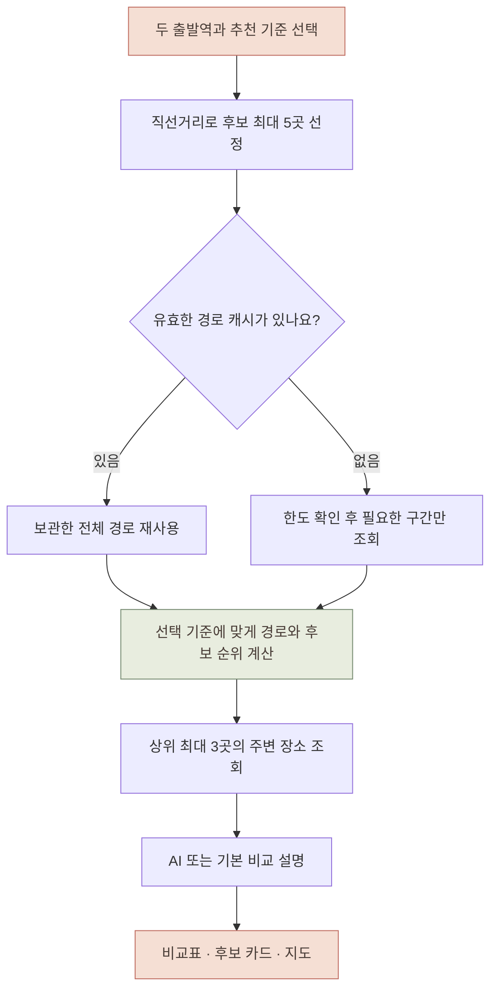

<a id="top"></a>

<div align="center">

# 우리 사이 ♡

**너와 나 사이, 만나고 싶은 곳.**

조금 덜 멀리, 조금 더 오래 함께.<br>
두 사람의 출발역으로 만남 후보를 찾고, 이동시간과 주변 장소를 함께 비교하는 서비스입니다.

`Python` · `HTML / CSS / JavaScript` · `Kakao API` · `Gemini 선택 연동`

[화면 미리보기](#preview) · [주요 기능](#features) · [빠른 시작](#quick-start) · [추천 과정](#flow) · [상세 가이드](#guide)

</div>

---

## 왜 만들었나요?

> “어디에서 만나야 두 사람 모두 덜 힘들고, 함께할 시간은 더 길어질까?”

지도에서 두 출발점의 가운데를 찾는 것만으로는 실제 이동 부담을 알기 어렵습니다. **이동시간·환승 횟수·시간 차이**를 비교하고, 도착한 뒤 함께할 장소까지 살펴볼 수 있도록 만든 Python 학습 프로젝트입니다.

경로 데이터와 선택한 기준으로 후보를 계산하고, AI는 조회한 정보를 바탕으로 장단점을 설명합니다. AI 설정이 없어도 기본 비교 기능을 사용할 수 있습니다.

<a id="preview"></a>

## 화면 미리보기

### 두 출발점이 만나는 첫 화면


| 데스크톱과 같은 감성을 모바일에서도 | 움직임에도 이유를 담았습니다 |
| :---: | :--- |
|  | **만남을 표현하는 경로**<br>두 출발점의 선과 점이 중앙 하트로 모입니다.<br><br>**스크롤에 맞춘 등장**<br>안내·검색·비교 영역이 차례로 나타납니다.<br><br>**기다리는 시간의 안내**<br>검색 중에는 두 점이 가까워지는 모션을 표시합니다.<br><br>**편안하게 읽는 화면**<br>모바일에서는 움직임을 줄이고, 모션 끄기와 운영체제 설정을 지원합니다. |

*이미지는 로컬 테스트 화면의 실제 캡처입니다. 정지 이미지에는 모션이 재생되지 않으며, 아래의 API 없는 미리보기로 인터랙션을 확인할 수 있습니다.*

<a id="features"></a>

## 주요 기능

| 기능 | 사용자에게 제공하는 것 |
| --- | --- |
| 🚉 두 출발역 검색 | 역 이름을 검색하고 이용할 노선을 선택 |
| ⚖️ 세 가지 추천 기준 | 이동 부담 줄이기 · 공평하게 만나기 · 환승 적게 하기 |
| 📍 후보 최대 3곳 비교 | 두 사람의 이동시간, 환승, 시간 차이를 표와 카드로 비교 |
| ☕ 주변 데이트 장소 | 카페·식사·문화시설 검색, 같은 주소 편중 완화, 출입 확인 단서 표시 |
| 🗺️ 카카오 지도 | 후보 역과 주변 장소를 함께 표시하고 카드와 연결 |
| 💬 AI 비교 설명 | 조회한 정보를 바탕으로 후보별 장단점 설명, 미사용·실패 시 기본 설명 |
| ⏱️ 10분 경로 캐시 | 같은 구간의 전체 경로를 재사용해 기준 변경 시 중복 호출 절약 |
| ♡ 감성적인 인터랙션 | 결과 공개 연출, 통통 튀는 버튼, 실제 진행 단계 표시, 다크 모드, 모바일 대응 |

**현재 범위:** 수도권 역 데이터 기반 · 로컬 실행 · JSON 결과 저장 · DB 없이 동작

<a id="quick-start"></a>

## 빠른 시작

### 1. 처음 내려받는 경우

Python이 설치된 Windows PowerShell에서 실행합니다. 이미 프로젝트와 가상환경이 있다면 **3번으로 이동**하세요.

```powershell
git clone https://github.com/jjuny0326/meet-in-between.git
cd meet-in-between
python -m venv .venv
.\.venv\Scripts\python.exe -m pip install requests python-dotenv
```

저장소의 `data/capital_stations.json`을 사용하므로 실행을 위해 원본 Excel 파일을 다시 준비할 필요는 없습니다. 역 데이터를 재생성할 때만 원본 자료와 `openpyxl`이 필요합니다.

### 2. API 키 준비

`.env`가 없다면 예제 파일을 복사하고 본인의 키를 입력합니다. 이미 설정한 `.env`는 유지하세요.

```powershell
if (-not (Test-Path .env)) { Copy-Item .env.example .env }
```

| 환경 변수 | 용도 | 필요 여부 |
| --- | --- | --- |
| `KAKAO_REST_API_KEY` | 출발역·경로·주변 장소 검색 | 실제 검색에 필요 |
| `KAKAO_JAVASCRIPT_KEY` | 카카오 지도 표시 | 지도 사용 시 필요 |
| `GEMINI_API_KEY` | AI 비교 설명 | 선택 |
| `GEMINI_FREE_TIER_CONFIRMED` | 무료 등급을 직접 확인했다는 표시 | AI 사용 시 `true` |

지도는 JavaScript SDK 도메인에 `http://127.0.0.1:8001`을 등록해야 합니다. 자세한 내용은 아래 **후보와 주변 장소 지도**, **AI 설명 켜기**를 참고하세요. 실제 키가 들어간 `.env`는 Git에 올리지 않습니다.

### 3. 웹 실행

프로젝트 폴더에서 실행합니다.

```powershell
.\.venv\Scripts\python.exe serve_web.py --port 8001
```

[http://127.0.0.1:8001](http://127.0.0.1:8001)에 접속한 뒤 **출발역 선택 → 추천 기준·활동 선택 → 만남 후보 찾기** 순서로 사용하세요. 터미널을 켜두고, 종료하려면 `Ctrl+C`를 누릅니다.

### API 없이 화면부터 살펴보기

```powershell
.\.venv\Scripts\python.exe tests/preview_web.py
```

[http://127.0.0.1:8002](http://127.0.0.1:8002)에서 가상 역을 검색하고 추천 화면·스크롤·로딩 모션을 확인할 수 있습니다. 실제 API 키와 호출량을 사용하지 않으며, 이 결과는 실제 추천 정보가 아닙니다.

<a id="flow"></a>

## 추천은 어떻게 만들어지나요?



직선거리로 추린 후보 안에서 비교합니다. 수도권 전체의 최적 장소를 보장하지 않으며, 공평 기준 조건에 따라 결과가 3곳보다 적을 수 있습니다.

<a id="guide"></a>

## 상세 가이드

관심 있는 항목을 펼쳐 설정 방법과 코드 흐름을 읽을 수 있습니다.

<details>
<summary><strong>현재 흐름</strong></summary>

1. 카페·식사·문화시설 중 원하는 활동을 선택합니다. 여러 개를 선택할 수 있습니다.
2. 두 사람의 출발역을 검색하고 선택합니다.
3. 저장한 역 목록에서 직선거리로 후보 최대 5곳을 고릅니다.
4. 선택한 추천 기준에 따라 경로와 후보 순위를 결정합니다. 기본은 ‘이동 부담 줄이기’이며 ‘공평하게 만나기’, ‘환승 적게 하기’도 선택할 수 있습니다.
5. 상위 3개 역 각각에서 선택한 종류의 장소를 반경 1km, 거리순 최대 15곳씩 한 번에 검색하고 주소 편중을 줄여 최대 5곳을 표시합니다.
6. 이동시간·환승·시간 차이·장소 목록·후보별 설명을 출력하고 JSON으로 저장합니다.

Gemini가 활성화되면 조회한 정보로 후보별 장단점과 추천 이유를 작성합니다. AI가 선택한 후보 번호와 기존 교통 순위는 별도로 표시합니다. 설정이 없거나 호출에 실패하면 계산한 사실에 기반한 기본 설명을 표시합니다.

</details>

<details>
<summary><strong>장소 편중과 출입 안내</strong></summary>

- 각 역의 활동 종류별로 서로 다른 주소의 장소를 1곳씩 먼저 선택합니다. 5곳이 안 되면 같은 주소에서 두 번째 장소까지 추가합니다. 같은 주소 최대 2곳이라는 제한은 부족해도 유지합니다.
- 도로명 주소의 건물번호를 기준으로 묶고 층·호수는 제외합니다. 도로명 주소가 없으면 지번 주소를 사용하며, 주소가 모두 없으면 개별 장소로 취급합니다. 주소는 건물의 대용 기준이므로 같은 부지의 여러 건물이 묶이거나 도로명/지번 표기가 섞인 장소가 나뉠 수 있습니다.
- `1루`, `외야`, `출국장`, `회원 전용` 같은 이름의 단서가 있으면 **출입 조건 확인 필요**를 표시합니다. 같은 주소의 다른 장소에서 발견한 단서는 간접 근거임을 따로 안내합니다. 표시가 실제 출입 제한을 뜻하지 않으며, 표시가 없다고 자유 출입을 확인한 것도 아닙니다.
- JSON에 `building_key`, `access_check_required`, `access_check_reasons`를 저장합니다. AI에도 확인 사유를 전달해 장단점에 반영하도록 합니다.
- 활동별 검색은 여전히 한 번입니다. 첫 15곳 안에서만 선별하므로 다른 건물의 매장이 부족하면 결과가 5곳보다 적을 수 있습니다. 추가 페이지를 자동 조회하지 않습니다. [카카오 장소 검색 API](https://developers.kakao.com/docs/ko/local/dev-guide#search-by-category)의 응답 수 설정을 사용합니다.

기존 저장 파일은 그대로 다시 보여줍니다. 새 선별 기준과 출입 안내를 적용하려면 일반 실행으로 다시 조회하세요. `--saved`와 `--explain-saved`는 과거 장소 목록을 다시 검색하거나 선별하지 않습니다.

</details>

<details>
<summary><strong>실행</strong></summary>

PowerShell에서 실행합니다. 기존 가상환경의 requests, python-dotenv를 사용하며 이번 확장에 추가 패키지는 필요하지 않습니다.

```powershell
cd C:\AI_project\date-meet
.\.venv\Scripts\python.exe station_search.py
```

활동 선택에 `1,3`을 입력하면 카페와 문화시설을 함께 비교합니다. Enter만 누르면 카페입니다.

저장 결과만 다시 보기 — 외부 API 호출 없음:

```powershell
.\.venv\Scripts\python.exe station_search.py --saved
```

저장된 정보로 AI 설명만 다시 작성하기 — 역·경로·장소 조회 없음. AI 설정과 자체 한도 검사를 통과하면 Gemini 1회 호출:

```powershell
.\.venv\Scripts\python.exe station_search.py --explain-saved
```

저장 파일은 `data/latest_comparison.json`이며 마지막 결과로 덮어씁니다. 과거 결과임을 알 수 있도록 조회 시각을 표시합니다.

</details>

<details>
<summary><strong>웹 비교 화면</strong></summary>

HTML·CSS·JavaScript에서 출발역을 검색하고 후보 최대 3곳을 비교합니다. 새 패키지 설치 없이 Python 표준 라이브러리 서버로 실행합니다.

```powershell
cd C:\AI_project\date-meet
.\.venv\Scripts\python.exe serve_web.py
```

터미널을 켜둔 채 브라우저에서 **http://127.0.0.1:8000**을 엽니다. 종료는 터미널에서 Ctrl+C입니다. 포트가 사용 중이면 `serve_web.py --port 8001`로 실행하고 해당 포트로 접속합니다. HTML 파일을 더블클릭하는 대신 로컬 서버 주소를 사용하세요.

- 세 후보의 두 사람 이동시간, 환승 횟수, 시간 차이와 합계를 나란히 표시합니다. 막대는 모든 후보에 같은 시간 기준을 적용합니다.
- 상단 요약표에서 후보별 시간과 환승을 한눈에 비교하고, 역 이름을 누르면 상세 카드로 이동합니다.
- 선택 기준 순·시간 차이 적은 순·환승 합계 적은 순으로 표시 순서를 바꿀 수 있습니다. 이 정렬은 이미 선정된 최대 3곳만 재배치하며 후보 번호와 AI 추천 대상은 유지됩니다.
- 카페·식사·문화시설 버튼으로 저장된 활동의 장소 목록을 전환합니다.
- 활동·정렬 도구는 스크롤 중에도 상단에 유지됩니다. 장소는 먼저 3곳(모바일 폭에서는 2곳)을 보여주고 ‘더 보기’로 나머지를 펼칩니다. 모바일에서는 후보별 ‘좋은 점 · 생각해 볼 점’도 접힌 상태로 시작하며, 지도는 후보 카드 뒤에 표시합니다. 접힌 장소에 출입 안내가 있어도 전체 확인 필요 건수는 카드에 표시합니다.
- 장소 이름을 누르면 카카오맵 상세 페이지가 새 탭에서 열립니다. 출입 안내를 누르면 확인 사유를 펼칩니다.
- AI 추천 후보와 설명을 강조하며, AI 미사용 결과는 기본 비교 안내로 표시합니다.
- ‘결과 다시 읽기’는 저장 파일만 다시 읽습니다. ‘결과 파일 열기’는 선택한 JSON을 브라우저 안에서 읽으며 파일을 서버로 업로드하지 않습니다.
- 모바일 너비에서는 카드가 세로로 배치됩니다. 파일 누락·잘못된 형식·장소 조회 실패는 별도 안내합니다.
- 본문·장소명·주소를 크게 표시하고, 요약표에서는 이동시간과 환승을 두 줄로 나눕니다. 숫자는 실제 값을 즉시 보여줍니다.
- 카드가 화면에 들어올 때 부드럽게 나타나고, 새 검색 결과는 ‘결과 열기’를 누르면 카드가 뒤집히듯 공개됩니다. 실제 이동시간 숫자는 즉시 표시합니다.
- 상단 ‘모션 줄이기’로 모든 모션을 끌 수 있으며 선택은 해당 브라우저에 저장됩니다. 운영체제의 모션 줄이기가 활성화되면 이를 우선 적용하고 진행 중인 모션도 중지합니다.

### 웜 라이트 디자인과 다크 모드

눈이 편한 웜 라이트 톤을 기본으로 합니다. 아이보리 바탕(#F6F1EA)에 크림 카드(#FFFCF7), 따뜻한 진회색 글자(#3A3330)를 쓰고 포인트 색은 더스티 로즈 하나만 사용합니다. 두 사람은 로즈(A)와 세이지 그레이(B)로 구분하며, 색과 함께 A·B 글자와 밝기 차이로도 구분됩니다.

- 색·글꼴은 `web/styles.css` 맨 위의 토큰(`--bg`, `--surface`, `--rose` 등)으로만 지정합니다. 다크 모드는 `[data-theme="dark"]`에서 같은 토큰의 값만 바꿉니다. 글자 대비는 배경 기준 4.5:1 이상을 목표로 했습니다.
- 상단의 달/해 버튼으로 라이트·다크를 바꾸며, 선택은 해당 브라우저에 저장됩니다. `web/theme.js`가 `<head>`에서 먼저 실행돼 화면이 그려지기 전에 테마를 적용하므로 깜빡이지 않습니다.
- 첫 화면은 왼쪽 소개 문구와 오른쪽 입력 카드로 구성해 데스크톱 첫 화면에서 바로 출발역을 입력할 수 있습니다. 추천 기준은 버튼 3개, 활동은 칩으로 고릅니다(내부적으로는 라디오·체크박스라 키보드와 화면 낭독기로도 조작할 수 있습니다).
- 새 검색 결과는 ‘두근두근, 결과 열기’ 단계를 거쳐 공개되고, 누르면 카드가 뒤집히듯 나타납니다. 저장된 결과를 다시 읽을 때와 모션을 줄인 경우에는 이 단계 없이 바로 표시합니다.
- 버튼·칩에는 눌렀을 때 살짝 튀는 반응이 있습니다. 상단 ‘모션 줄이기’ 또는 운영체제의 모션 줄이기 설정을 켜면 모든 애니메이션을 멈춥니다.
- 모바일(폭 760px 이하)에서는 화면 아래 단계형 탭(① 찾기 → ② 결과 → ③ 지도)으로 화면을 나눠 보여 줍니다. 결과가 생기기 전에는 ②·③이 흐리게, 다른 탭을 보는 중에 새 결과가 생기면 ②에 점이 표시됩니다. 이용 안내와 모션 설정은 상단 ⓘ 버튼에 있습니다. 모바일 찾기 화면은 장식을 빼고 입력 카드만, 결과 화면은 추천 요약(긴 설명은 3줄 + ‘더 보기’) → 후보 카드 → 비교 표 순서로 보여 줍니다. 검색이 끝나면 결과 탭으로, 카드의 ‘지도에서 보기’를 누르면 지도 탭으로 자동 이동합니다. 각 영역의 `data-view` 속성에 속한 탭을 적어 두고, `web/tabs.js`가 `<html data-tab>` 값을 바꾸면 CSS가 해당 영역만 보여 주는 방식입니다. 데스크톱은 지금처럼 한 페이지에 모두 표시합니다.
- 결과는 모든 화면 크기에서 추천 요약 → 추천 카드 → 다른 선택지 → 비교 표 순서입니다. 결과 첫 화면 안에 추천 역과 두 사람의 이동시간이 보이도록 머리말과 부가 설명을 줄였고, 긴 추천 설명은 잘릴 때만 ‘설명 더 보기’ 버튼이 나타납니다. 960px 이하에서는 추천 카드가 위, 다른 선택지 두 곳이 아래 두 칸으로 놓입니다.
- 지도의 후보 선택 버튼은 지도 위에 떠 있습니다. 모바일 ③ 지도 탭을 열면 결과가 있을 때 지도를 자동으로 한 번 불러오고(실패하면 버튼으로 다시 시도), 지도가 화면을 채웁니다. 데스크톱은 지금처럼 ‘지도 불러오기’를 눌러야 지도 SDK를 불러옵니다.
- 글꼴은 Google Fonts의 Noto Sans KR(본문)과 Space Grotesk(숫자·영문)를 사용합니다. 인터넷에 연결되지 않으면 기기의 기본 고딕 글꼴로 표시됩니다. 서버의 보안 설정(CSP)에 두 글꼴 주소만 허용했습니다.

디자인과 모션은 외부 API 호출을 추가하지 않습니다. 변경 후 브라우저에서 강력 새로고침(Ctrl+F5)하면 새 스타일을 확인할 수 있습니다.

상단에서 두 출발역의 이름을 입력하면 수도권 역 목록(`data/capital_stations.json`)에서 후보가 나타납니다. 역과 노선을 고르고 활동을 선택한 다음 **만남 후보 찾기**를 누릅니다. 입력 중에는 외부 API를 호출하지 않으며, 목록에 없는 역을 찾으려고 ‘역 검색’을 누를 때만 카카오 검색을 사용합니다. 새 추천은 Python 서버를 거쳐 기존 경로·장소·AI 기능을 사용합니다. 키는 서버의 `.env`에서 읽으며, 지도용 JavaScript 키만 브라우저로 전달합니다. 키를 바꾸면 서버를 재시작하세요.

검색하는 동안 입력을 잠그고 같은 서버에서 동시 API 요청을 거부합니다. 유효한 캐시에 없는 구간만 계산해서, 필요한 경로 호출 횟수가 부족하면 새 경로 조회 전에 안내하고 기존 결과를 유지합니다. 역 선택은 서버 재시작 또는 1시간 경과 후 만료되어 다시 검색해야 합니다. 검색 중에는 버튼 아래에 서버가 알려준 실제 진행 단계(후보 역 고르기 → 경로 확인 → 주변 장소 찾기 → 설명 정리)와 ‘경로를 새로 조회하고 있어요 · 3번째’ 같은 안내가 표시됩니다. 시간에 맞춘 가짜 진행률이 아닙니다. 연결이 잠깐 끊겨도 같은 작업을 다시 조회하며(연속 4회까지), 계속 실패하거나 서버를 재시작했다면 새 추천을 반복하기보다 ‘결과 다시 읽기’로 완료 여부를 먼저 확인하세요.

서버는 127.0.0.1에만 연결하고 지정한 화면 파일·결과 JSON·검색 API만 제공합니다. `.env`나 사용량 파일은 제공하지 않습니다. 로컬 학습용 서버이므로 인터넷에 공개하는 배포 서버로 사용하지 않습니다. **웹 서버 여러 개와 콘솔 검색을 동시에 실행하지 마세요.** 호출량 제한은 별도 프로세스 간 동시 실행까지 제어하지 않습니다.

</details>

<details>
<summary><strong>선택 사항: AI 설명 켜기</strong></summary>

지도 설정은 아래 ‘후보와 주변 장소 지도’를 참고하세요. AI 설정과는 별개입니다.

현재 .env의 카카오 키를 유지하고 다음 항목을 추가합니다. 실제 키는 공유하거나 Git에 올리지 않습니다.

```dotenv
GEMINI_API_KEY=본인의_Gemini_API_키
GEMINI_FREE_TIER_CONFIRMED=false
```

Google AI Studio에서 **해당 키의 프로젝트가 Free Tier인지**, 모델 사용 가능 여부와 할당량을 확인한 뒤에만 `GEMINI_FREE_TIER_CONFIRMED=true`로 변경합니다. 이 설정은 사용자의 확인 표시이며 프로그램이 결제 상태를 조회하거나 과금을 차단하는 기능은 아닙니다. 유료 전환은 하지 않습니다.

사용 모델은 `gemini-3.5-flash-lite`입니다. [공식 가격표](https://ai.google.dev/gemini-api/docs/pricing)와 [계정별 한도 안내](https://ai.google.dev/gemini-api/docs/rate-limits)를 확인하세요. 계정·지역별 이용 가능 여부와 무료 등급 데이터 이용 조건도 확인해야 합니다.

AI에는 후보 역 이름, 이동시간, 환승 횟수, 활동 종류, 장소 이름과 분류를 보냅니다. 출발역과 정밀 좌표, 주소, API 키를 프롬프트에 포함하지 않습니다. 실제 데이터에 근거하도록 지시하고 응답 구조를 검사하지만 설명의 사실성을 완전히 보장하지는 않습니다.

</details>

<details>
<summary><strong>호출량 관리</strong></summary>

| 종류 | 새 비교 1회 기준 | 코드 자체 제한 |
| --- | --- | --- |
| 출발역 검색 | 자동완성으로 고르면 0회, ‘역 검색’을 누르면 누를 때마다 1회 | 자동 재시도 없음 |
| 경로 조회 | 캐시에 없는 구간만 최대 10회, 모두 재사용하면 0회 | 한국 시간 하루 20회 |
| 주변 장소 | 상위 3곳 × 선택한 활동 수 = 최대 9회 | 자동 재시도 없음 |
| AI 설명 | 설정된 경우 1회 | 한국 시간 하루 10회, 요청 간격 최소 60초 |

실패한 요청도 경로·AI 사용량에 포함합니다. 사용량 파일이 손상되면 해당 호출을 중단합니다. 이 제한은 단일 프로세스 로컬 학습용으로, 동시 실행이나 다른 앱의 같은 키 사용량까지 통제하지 못합니다. 공급자의 무료 설정·쿼터는 별도로 확인해야 합니다. 자체 제한은 공식 무료 할당량을 뜻하지 않습니다.

</details>

<details>
<summary><strong>파일 역할과 추천 범위</strong></summary>

- `station_search.py`: 웹·콘솔이 공유하는 역 검색과 추천 계산, 콘솔 실행 흐름.
- `route_cache.py`: 구간별 전체 경로를 10분간 메모리에 보관하고 필요한 호출 횟수 계산.
- `comparison.py`: 활동 선택, 장소 검색, AI/기본 설명, 출력과 JSON 저장.
- `recommendation_policy.py`: 세 추천 기준에 따른 경로 선택과 후보 순위 계산.
- `load_stations.py`: 원본 자료로 data/capital_stations.json 생성.
- `station_catalog.py`: data/capital_stations.json으로 출발역 자동완성. 역 이름의 ‘역’ 표기를 통일하고, 데이터로 확인된 노선만 흔히 쓰는 이름을 덧붙입니다(예: 경인선 → 1호선 (경인선)). 경원선처럼 1호선·경의중앙선 역이 섞인 노선은 그대로 표시합니다.
- `web/index.html`, `web/styles.css`, `web/app.js`: 화면 구조, 디자인, 데이터 표시와 활동 전환.
- `web/search.js`: 출발역 선택 상태, 검색 요청, 로딩과 오류 안내.
- `web/map.js`: 지도 SDK 로딩, 후보·장소 마커 표시와 카드 연결.
- `serve_web.py`: 화면 제공, 역 검색·추천 API, 선택한 역 검증과 동시 요청 차단.
- `tests/test_comparison.py`: 실제 외부 호출 없이 비교와 실패 처리 검증.

직선거리로 먼저 고른 후보만 비교하므로 수도권 전체의 최적 지점을 보장하지 않습니다. 노선별 기록은 같은 역을 여러 번 포함할 수 있습니다. 주변 장소 검색 건수는 전체 시설 수나 인기도가 아니며 가격·영업시간·분위기는 확인하지 않습니다. 문화시설 검색은 현재 진행 중인 전시·공연 일정 검색과 다릅니다.

```powershell
.\.venv\Scripts\python.exe -m unittest discover -s tests -v
```

Node.js가 설치되어 있다면 화면 로직도 검증할 수 있습니다. 실제 외부 API를 호출하지 않습니다.

```powershell
node --test tests/web.test.cjs tests/search.test.cjs tests/map.test.cjs
```

공식 자료: [카카오맵 REST API](https://developers.kakao.com/docs/ko/kakaomap/rest-api), [카카오 쿼터와 요금](https://developers.kakao.com/docs/ko/getting-started/quota), [Gemini 콘텐츠 생성](https://ai.google.dev/api/generate-content).

</details>

<details>
<summary><strong>코드 이해하기: 버튼 하나가 결과가 되기까지</strong></summary>

1. `web/index.html`은 입력칸·버튼·결과 영역을 만들고, `web/styles.css`는 배치와 색상을 정합니다.
2. 역 이름을 입력하면 0.2초 뒤 `web/search.js`의 `suggestStations()`가 `GET /api/station-suggestions?query=...`로 로컬 역 목록 후보(최대 6개)를 받습니다. 외부 API를 쓰지 않으며, 고른 역은 `local-번호`로 서버에 전달됩니다. 목록에 없는 역은 ‘역 검색’을 눌러 `findStations()`가 `GET /api/stations?query=...`(카카오)로 찾습니다. `fetch()`는 브라우저에서 서버로 HTTP 요청을 보내는 함수입니다.
3. `serve_web.py`의 `station_search()`가 `station_search.py`의 `search_stations()`를 호출합니다. 카카오 응답의 실제 역 정보는 서버가 보관하고, 화면에는 이름·주소와 임시 선택 번호(`token`)를 돌려줍니다. 이 번호는 API 키가 아닙니다.
4. 사용자가 노선을 고르면 `searchState.selected`에 선택 번호가 저장됩니다. 입력한 역 이름을 수정하면 기존 선택은 해제됩니다. 두 역과 활동을 모두 선택해야 추천 버튼이 활성화됩니다.
5. 추천 버튼은 선택 번호 2개와 활동 목록을 JSON으로 `POST /api/recommendations`에 보냅니다. JSON은 Python과 JavaScript가 데이터를 주고받는 공통 텍스트 형식입니다.
6. 서버의 `recommend()`는 입력을 검사하고 선택 번호를 실제 역 정보로 바꾼 뒤, 계산을 백그라운드 스레드(`run_job()`)로 넘기고 즉시 `202`와 작업 번호(`job_id`)를 돌려줍니다. 화면(`web/search.js`의 `waitForJob()`)은 1초마다 `GET /api/recommendations/<job_id>`로 진행 단계·완료 여부·결과를 조회합니다(폴링). 작업이 끝날 때까지 `API_LOCK`은 작업 스레드가 쥐고 있으므로 다른 추천·역 검색은 `409`로 거부됩니다. 작업 기록은 서버 메모리에만 있어 재시작하면 사라집니다. 계산 함수 `build_recommendation()`은 `on_stage(단계, 안내문)` 콜백으로 실제 단계를 알립니다. 이 함수는 사용자에게 `input()`을 요구하지 않고 결과 딕셔너리를 반환합니다. 그래서 같은 계산을 콘솔과 웹이 함께 사용할 수 있습니다.
7. 계산 순서는 **직선거리 후보 5곳 → 유효한 경로 캐시 확인 → 없는 구간의 호출 한도 확인·조회 → 선택 기준에 맞는 경로 선택 → 후보 순위 계산 → 상위 최대 3곳의 주변 장소 조회 → AI 또는 기본 설명**입니다. 기본 기준은 두 사람 중 더 긴 이동시간, 동률이면 합계입니다. 다른 기준의 계산법은 아래 표를 참고하세요.
8. `save_report()`가 마지막 결과를 저장하면 작업 상태가 `done`이 되고, 다음 조회 응답에 결과가 담깁니다. `web/app.js`의 `showReport()`가 이를 검사한 후 표와 카드를 그립니다. 정렬·활동 전환은 받은 데이터로 처리하므로 외부 API를 다시 호출하지 않습니다.

`try / except`(Python)와 `try / catch / finally`(JavaScript)는 실패를 안내하고 잠긴 버튼을 복구하는 데 사용합니다. `API_LOCK`은 같은 서버에서 두 추천이 동시에 사용량 파일을 수정하는 것을 막습니다. 브라우저 버튼 잠금만으로는 다른 탭의 요청을 막을 수 없어 서버에서도 검사합니다.

외부 API를 전혀 쓰지 않는 화면 점검은 `python tests/preview_web.py` 실행 후 `http://127.0.0.1:8002`에서 가능합니다. 이름에 ‘테스트’가 붙은 가상 역을 사용하며 실제 저장 결과와 호출량을 변경하지 않습니다. ‘없음’을 검색하면 검색 결과 없음 상태를 확인할 수 있습니다.

</details>

<details>
<summary><strong>후보와 주변 장소 지도</strong></summary>

### 한 번만 필요한 설정

1. [카카오 개발자 콘솔](https://developers.kakao.com)에 접속해 **기존 REST API 키를 사용 중인 앱**을 선택합니다.
2. [앱] → [플랫폼 키]에서 JavaScript 키를 확인합니다. 해당 키의 **JavaScript SDK 도메인**에 `http://127.0.0.1:8001`을 등록합니다. `localhost`나 다른 포트로 접속한다면 그 주소도 정확히 등록해야 합니다.
3. [카카오맵] → [사용 설정]이 ON인지 확인합니다. 무료 범위로 사용하려면 기존 앱의 무료 쿼터 적용 여부를 확인하고 유료 사용 설정은 켜지 않습니다. [공식 사용 안내](https://developers.kakao.com/docs/ko/kakaomap/common)에 따르면 무료 쿼터는 개발자 계정에서 카카오맵을 처음 활성화한 앱에 적용됩니다.
4. 프로젝트의 `.env`에 다음 줄을 추가합니다. 기존 REST API 키는 그대로 둡니다.

```dotenv
KAKAO_JAVASCRIPT_KEY=카카오에서_확인한_JavaScript_키
```

5. 서버를 재시작하고 `http://127.0.0.1:8001`에 접속합니다.

```powershell
.\.venv\Scripts\python.exe serve_web.py --port 8001
```

JavaScript 키는 지도 SDK가 브라우저에서 사용하는 공개 클라이언트 키입니다. 서버는 `/api/map-config`에서 이 키만 반환하며 REST API 키와 Gemini 키는 보내지 않습니다. 허용 도메인으로 사용처를 제한합니다. [.env.example](.env.example)은 빈 설정 예시이며 실제 키를 넣은 `.env`는 Git에 올리지 않습니다. [공식 지도 시작 가이드](https://apis.map.kakao.com/web/guide/) 참고.

### 사용법과 동작

- 결과의 **지도 불러오기**를 누르면 SDK를 한 번 불러옵니다. 기존 검색 결과의 좌표를 사용하므로 경로·장소 API를 다시 조회하지 않습니다. 지도 SDK 자체 사용량은 공급자의 별도 쿼터에 적용되며 앱의 경로 20회 제한에는 포함하지 않습니다.
- 큰 번호는 후보 역, 작은 `후보번호·장소번호` 표시는 선택한 활동의 장소입니다. 후보마다 색상이 다릅니다. 장소번호는 각 후보의 장소 목록 순서입니다.
- ‘전체 후보’ 또는 특정 후보 버튼으로 표시 범위를 선택합니다. 카페·식사·문화시설 탭을 바꾸면 지도도 함께 바뀝니다. 표시 범위는 버튼을 누르거나 활동을 바꿀 때 자동 조정됩니다.
- 마커를 누르면 지도 아래에 상세 정보와 해당 후보 카드로 가는 버튼이 나타납니다. 같은 좌표에 겹치는 장소는 `+숫자`로 묶고 상세 목록에 모두 표시합니다.
- 카드의 **지도에서 보기**, 장소의 **위치 보기**를 누르면 지도에서 해당 후보나 장소를 확인할 수 있습니다. 확대·축소는 지도 오른쪽 버튼을 사용합니다. 페이지 스크롤이 확대 동작으로 바뀌지 않도록 마우스 휠 확대는 껐습니다.
- 과거 저장 파일에는 장소 좌표가 없을 수 있습니다. 이런 경우 좌표 있는 역만 표시하고 누락 건수를 안내합니다. 좌표를 추측하거나 자동으로 재조회하지 않습니다. 새로운 장소 좌표를 저장하려면 새 추천 검색이 필요하며, 이때는 기존 경로·장소 호출량이 사용됩니다.
- 지도 설정 누락·SDK 실패가 있어도 후보 카드와 표는 사용할 수 있습니다. 지도는 위치 표시용이며 실제 이동 경로나 도보 시간을 그리지 않습니다.

### 코드 흐름

`comparison.py`가 장소 검색 응답의 `x`(경도), `y`(위도)를 결과에 저장합니다. `web/app.js`가 비교 카드를 그린 뒤 `MeetingMap.update()`에 현재 결과와 활동을 전달합니다. `web/map.js`의 `pointsFor()`는 유효한 좌표를 골라내고, `draw()`는 카카오 지도 위에 클릭 가능한 표시를 만듭니다. `focus()`는 카드에서 고른 후보/장소로 지도 범위를 바꿉니다. SDK와 지도 객체는 재사용하며 표시만 교체합니다.

지도 검증은 `tests/map.test.cjs`에서 모의 SDK로 수행합니다. 실제 지도 배경과 도메인 인증은 JavaScript 키 설정 후 브라우저에서 확인해야 합니다.

</details>

<details>
<summary><strong>추천 기준 선택</strong></summary>

출발역 입력 아래의 ‘어떤 만남을 우선할까요?’에서 선택한 다음 **만남 후보 찾기**를 누릅니다. 선택만 바꿔서는 API를 호출하거나 기존 결과를 변경하지 않습니다. 새 추천은 캐시에 없는 구간만 최대 10회 조회합니다. 같은 구간의 경로가 모두 유효하면 기준을 바꿔도 추가 경로 호출은 0회입니다. 주변 장소·AI 호출은 별도입니다.

| 기준 | 각 사람의 경로 선택 | 후보 선정 순서 |
| --- | --- | --- |
| 이동 부담 줄이기 (`burden`, 기본값) | 가장 빠른 경로, 동률이면 환승이 적은 경로 | 두 사람 중 더 긴 시간 → 시간 합계 |
| 공평하게 만나기 (`fair`) | 가장 빠른 경로, 동률이면 환승이 적은 경로 | 허용 시간 조건 적용 → 시간 차이 → 더 긴 시간 → 시간 합계 |
| 환승 적게 하기 (`transfers`) | 환승이 가장 적은 경로, 동률이면 빠른 경로 | 두 사람의 환승 합계 → 더 긴 시간 → 시간 합계 |

공평 기준은 다섯 후보의 ‘더 긴 이동시간’ 중 최솟값에 **15분**을 더한 값 이내의 후보만 비교합니다. 예를 들어 가장 부담이 적은 후보가 A 30분/B 40분이면, 더 오래 걸리는 사람이 55분 이내인 후보만 남깁니다. A 90분/B 90분인 후보는 시간 차이가 0이어도 제외합니다. 조건을 만족하는 후보가 1~2곳이면 그대로 표시하며, 세 곳을 채우기 위해 제한을 풀지 않습니다. 15분은 공식 교통 기준이 아닌 프로젝트의 초기 설정으로 `FAIR_EXTRA_MINUTES`에서 조정할 수 있습니다.

환승 기준에서는 더 느린 경로가 선택될 수 있습니다. 모든 기준은 API가 반환한 경로와 직선거리로 추린 후보 안에서 비교하므로 수도권 전체의 최적 경로·역을 보장하지 않습니다. 같은 출발역이라도 후보나 경로가 달라질 수 있으며, 입력에 따라 세 기준의 결과가 같을 수도 있습니다.

추천 계산은 `recommendation_policy.py`에 모았습니다. `select_route()`는 각 사람의 경로를 고르고 `rank_candidates()`는 모든 초기 후보를 순위화합니다. 그 후 `enrich_recommendations()`가 최대 세 곳의 장소를 조회합니다. 프론트엔드에서 세 카드의 순서만 바꾸는 기능과 다릅니다.

JSON에 `recommendation_mode`, `recommendation_note`를 저장합니다. 결과 상단에는 실제 계산에 사용한 기준을 표시하고, 새 결과를 받으면 표시 정렬을 ‘선택 기준 순’으로 초기화합니다. 과거 파일에 기준이 없으면 기존 방식인 `burden`으로 해석합니다. AI에도 기준과 경로 선택 규칙을 전달합니다. `--explain-saved`는 저장된 기준으로 설명만 갱신하고 재선정하지 않습니다.

콘솔에서도 선택할 수 있습니다:

```powershell
.\.venv\Scripts\python.exe station_search.py --mode fair
.\.venv\Scripts\python.exe station_search.py --mode transfers
```

기준을 생략하면 기존의 이동 부담 기준을 사용합니다. `tests/test_recommendation_policy.py`는 세 기준의 후보 차이, 공평 기준 경계, 환승 경로 선택을 외부 호출 없이 검증합니다.

</details>

<details>
<summary><strong>경로 재사용: 메모리 캐시</strong></summary>

추천 기준을 바꿀 때 같은 구간을 반복 조회하지 않도록, 검증을 통과한 **전체 경로 목록**을 서버 메모리에 10분간 보관합니다. 가장 빠른 경로 하나만 저장하면 ‘환승 적게 하기’로 바꿀 때 다른 경로를 선택할 수 없으므로 목록 전체가 필요합니다.

1. `build_recommendation()`이 두 출발역에서 후보 역들까지의 구간을 만듭니다.
2. `RouteCache.load_batch()`가 시작 시점에 유효한 경로를 확보하고, 없는 구간만 중복 없이 셉니다. `ensure_route_capacity()`는 이 횟수만 검사합니다.
3. 없는 구간은 기존 `get_transit_routes()`로 조회합니다. 성공한 응답만 원래 조회 시각과 함께 보관합니다. 뒤쪽 구간에서 실패해도 앞서 성공한 구간은 남습니다.
4. `select_route()`가 보관된 전체 목록에서 이번 기준에 맞는 경로를 고르고, `rank_candidates()`가 후보 순위를 다시 계산합니다.
5. 화면은 **재사용 건수·새 경로 조회 횟수·원래 조회 시각**을 표시합니다. ‘결과 작성’ 시각은 이번 비교 결과를 만든 시각이며 경로 조회 시각과 다를 수 있습니다.

캐시는 출발·도착 좌표와 API 키의 해시로 구분합니다. 왕복 방향은 별개이고 추천 기준은 캐시 구분에 넣지 않습니다. 좌표를 반올림하지 않으며 다른 API 키의 경로를 섞지 않습니다. 키 원문을 캐시 식별자로 보관하지 않습니다.

- 경로 조회 완료부터 600초 동안 유효하며, 재사용해도 만료 시각을 연장하지 않습니다. 비교 시작 때 확보한 경로는 그 비교가 끝날 때까지 사용합니다.
- 최대 200개 구간을 보관하고 초과하면 가장 먼저 저장한 구간부터 제거합니다.
- 브라우저 새로고침은 캐시를 지우지 않지만 **서버를 재시작하면 초기화**됩니다. 콘솔을 새로 실행할 때도 이전 프로세스의 캐시가 이어지지 않습니다. 저장 결과 JSON을 읽어도 캐시는 복원되지 않습니다.
- 경로 사용량이 하루 20회에 도달했어도 필요한 경로가 모두 유효하게 보관돼 있으면 재계산할 수 있습니다. 하나라도 새 조회가 필요하면 기존 한도 검사를 적용합니다.
- 주변 장소와 AI는 이 캐시에 포함하지 않으며 기존 호출·간격 제한을 유지합니다. 실패한 실제 경로 요청도 기존과 같이 사용량에 포함합니다.

결과 JSON의 `route_usage`에는 집계와 가장 이른/늦은 조회 시각, 보관 시간을 저장합니다. 각 후보의 `route_a`, `route_b`에는 `source`(`cache` 또는 `api`)와 `fetched_at`을 저장합니다. 이전 저장 파일에 이 정보가 없어도 열 수 있지만 재사용 기록은 없다고 안내합니다. 저장 결과의 기록은 그 결과를 계산했을 때의 정보이며 현재 캐시 상태를 뜻하지 않습니다.

확인하려면 수정 후 서버를 한 번 재시작하고 두 출발역으로 검색합니다. 서버를 계속 켜둔 채 10분 안에 추천 기준만 바꾸고 다시 검색하면, 같은 10개 구간 기준으로 **첫 검색: 새 조회 10회 → 다음 검색: 재사용 10건·새 조회 0회**가 됩니다. 구간 중복이나 후보 수에 따라 횟수는 더 적을 수 있습니다.

`tests/test_route_cache.py`는 외부 API 없이 재사용, 전체 목록 보존, 방향 구분, 만료, 실패, 부분 캐시, 동시 요청, 메모리 상한과 추천 기준 변경을 검증합니다. `tests/preview_web.py`에서도 같은 화면 흐름을 가상 데이터로 확인할 수 있습니다. 이 화면의 ‘새 조회’는 모의 조회 횟수이며 실제 API 호출량을 사용하지 않습니다.

</details>

---

<div align="center">

**우리 사이** · 만나는 과정도 좋은 시간으로.

[처음으로 돌아가기 ↑](#top)

</div>
